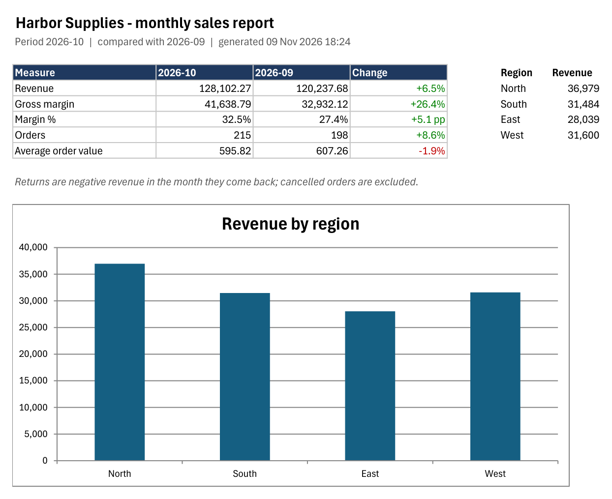
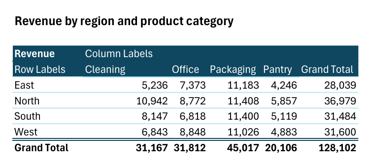
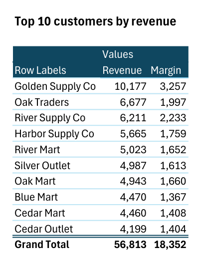
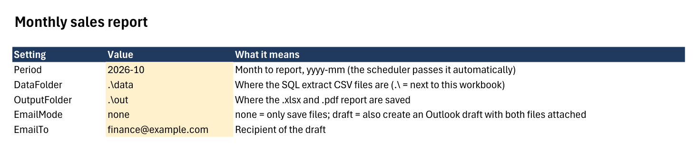

# Monthly Excel sales report: SQL + VBA, checked against the database

**Database → SQL extract → Excel macro → KPI summary, pivots, chart, .xlsx + PDF (and an Outlook draft), every month, with a test that proves the numbers match the database.**



## The problem this solves

Every month someone exports sales from the ERP, pastes it into Excel, rebuilds the pivots, fixes the chart,
saves a PDF and emails it. It takes half a day, and nobody checks whether the totals still match the system.

This project does the same job in about 3 seconds, the same way every month:

| Step | Where | What happens |
|---|---|---|
| 1 | [`sql/monthly_extract.sql`](sql/monthly_extract.sql) | One row per invoiced order line for the month; cancelled orders out, returns as negative revenue |
| 2 | [`scripts/extract.py`](scripts/extract.py) | Runs the SQL for this month and last month, writes CSV + control totals |
| 3 | [`vba/ReportBuilder.bas`](vba/ReportBuilder.bas) in `MonthlyReport.xlsm` | Builds the report workbook: Summary, pivots, chart, data table |
| 4 | same macro | Saves `Sales-Report-yyyy-mm.xlsx` (no macros, safe to send) and a PDF of the summary; optional Outlook draft with both attached |
| 5 | [`scripts/run_report.ps1`](scripts/run_report.ps1) | Unattended run for Windows Task Scheduler; exits with an error code if the macro reports a failure |
| 6 | [`test/verify.py`](test/verify.py) | Reads the finished .xlsx and compares every KPI with the SQL control totals |

## What is in the report

- **Summary**: revenue, gross margin, margin %, orders and average order value, this month vs last month (green up, red down, margin change in percentage points), plus revenue by region as a chart.
- **By region**: pivot of revenue by region × product category.
- **Top customers**: pivot of the 10 biggest customers by revenue, with margin.
- **Data**: the extract as an Excel table, so finance can filter and check any number.





## Settings and log

Everything a client changes is on the **Settings** sheet: period, folders, email mode and recipient.
The **Build report** button runs it by hand; the scheduler passes the period itself.
Every run writes one line to the **Log** sheet: time, period, OK or FAILED, and the reason.



## Tested, not just "it runs"

```
python test/verify.py 2026-10
OK   revenue: report 128102.27 / SQL 128102.27
OK   gross margin: report 41638.79 / SQL 41638.79
OK   orders: report 215 / SQL 215
OK   revenue change: report 0.0654... / SQL 0.0654...
OK   regions add up to revenue ...
OK   top customers sorted by revenue ...
ALL CHECKS PASSED
```

Two things the test caught while building this:

1. **Rounding.** The first control total rounded only the grand total; the report adds amounts already rounded per line,
   like an invoice does. The difference was 6 cents on 128,102. The control query now rounds per line, and the README
   of any report should say which rule it uses, because finance will find those cents.
2. **Failure handling.** A VBA error thrown back to a script (`Application.Run`) can close a hidden Excel instead of
   reaching the caller. The macro therefore never raises: it logs the reason and returns `FAILED: <reason>`, and
   `run_report.ps1` turns that into a non-zero exit code the scheduler can alert on. Tested with a month that has no data.

## Run it

Requirements: Windows with Excel, Python 3 with `openpyxl` (only for the test).

```
python scripts/make_data.py              # fictitious database data/sales.db (Sep and Oct 2026)
powershell -File scripts/build_xlsm.ps1  # creates MonthlyReport.xlsm (Settings, Log, button)
```

Then import the macro once: open `MonthlyReport.xlsm`, Alt+F11, select *VBAProject (MonthlyReport.xlsm)*,
File → Import File → `vba/ReportBuilder.bas`, save. (A script could import it too, but only after switching on
"Trust access to the VBA project object model"; this repo does not change that security setting for you.)

```
powershell -File scripts/run_report.ps1 -Period 2026-10   # extract + report
python test/verify.py 2026-10                             # compare report with SQL
```

For a monthly schedule, point Task Scheduler at `run_report.ps1` without `-Period`: it reports the previous month.
Set **EmailMode** to `draft` to get an Outlook draft with the .xlsx and PDF attached, ready for a person to press Send.

## Your own data

The data here is fictitious (company "Harbor Supplies", seeded generator). For a real client only the SQL changes:
the macro expects these columns in the extract: `Order, Date, Customer, Region, Segment, Category, Product, Qty, Revenue, Margin`.
The same extract can come from SQL Server, MySQL, PostgreSQL, Db2 or an ERP export.

---
Dodik Setyawan · back-office developer (banking) · [github.com/dodikibmi](https://github.com/dodikibmi)
